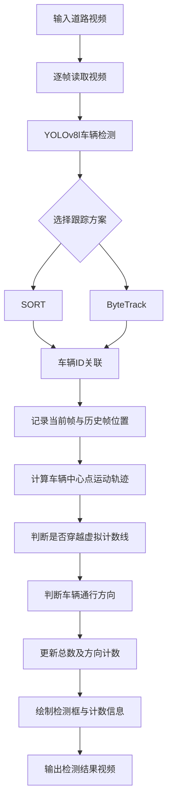

# Multi-Car Detection and Tracking

基于 **YOLOv8l + SORT / ByteTrack** 的多车辆检测、目标跟踪与交通流量统计项目。通过 YOLOv8 对道路视频中的车辆进行检测，结合多目标跟踪算法实现车辆跨帧 ID 关联，并利用虚拟计数线统计不同方向的车辆通行数量。

项目实现了两种跟踪方案：自定义 SORT 跟踪器和 YOLOv8 集成的 ByteTrack 跟踪器，可用于对比不同多目标跟踪方法在车辆检测与计数任务中的表现。

## 1. 项目简介

在道路监控场景中，仅依靠目标检测模型逐帧识别车辆，无法判断连续帧中的目标是否属于同一辆车，也难以准确统计车辆通行数量。

本项目使用 YOLOv8l 进行车辆检测，并引入多目标跟踪算法，为连续帧中的车辆分配相对稳定的跟踪 ID。通过记录车辆前后帧的位置变化，判断车辆是否穿越指定的虚拟计数线，从而实现车辆总数及不同通行方向的统计。

项目包含两种实现方案：

- **方案一：YOLOv8l + SORT**：结合卡尔曼滤波和匈牙利算法，实现车辆运动状态预测与检测框关联。
- **方案二：YOLOv8l + ByteTrack**：使用 Ultralytics 提供的跟踪接口，利用高、低置信度检测框进行分阶段关联，提高跟踪连续性。

## 2. 核心功能

- **车辆目标检测：** 使用 YOLOv8l 检测道路视频中的车辆。
- **多目标跟踪：** 分别使用 SORT 和 ByteTrack 实现跨帧车辆 ID 关联。
- **车辆轨迹关联：** 通过跟踪 ID 和前后帧边界框位置，记录车辆运动状态。
- **虚拟计数线检测：** 通过线段相交判断车辆是否穿越指定计数线。
- **双向车辆计数：** 根据车辆前后帧的位置变化区分通行方向。
- **实时结果可视化：** 在视频帧中绘制检测框、车辆 ID、虚拟计数线及计数结果。
- **视频结果保存：** 将处理后的视频保存到指定输出目录。

## 3. 系统流程



## 4. 关键技术与实现

### 4.1 YOLOv8l 车辆检测

采用 YOLOv8l 作为目标检测模型，加载预训练权重 `yolov8l.pt`，对视频中的车辆进行检测。

项目选取 COCO 数据集中的三类车辆：

| 类别 ID | 车辆类别 |
|---|---|
| 2 | Car（小汽车） |
| 5 | Bus（公交车） |
| 7 | Truck（卡车） |

主要检测参数：

| 参数 | 设置 |
|---|---|
| Model | YOLOv8l |
| Confidence Threshold | 0.3 |
| IoU Threshold | 0.4 |
| Detection Classes | [2, 5, 7] |

通过类别过滤，仅保留汽车、公交车和卡车的检测结果，减少无关目标对后续跟踪与计数的干扰。

### 4.2 SORT 多目标跟踪

在 `yolov8l_soft.py` 中实现 YOLOv8l + SORT 方案。

SORT（Simple Online and Realtime Tracking）主要由卡尔曼滤波和匈牙利算法组成。

具体流程：

1. 使用 YOLOv8l 获取当前帧的车辆检测框及置信度。
2. 利用卡尔曼滤波预测已有车辆轨迹在当前帧中的位置。
3. 计算检测框与预测跟踪框之间的 IoU。
4. 使用匈牙利算法进行检测框与历史轨迹的关联匹配。
5. 根据匹配结果更新已有轨迹，或为新出现的车辆创建跟踪器。
6. 为不同车辆分配跟踪 ID。

项目中的 SORT 参数：

| 参数 | 设置 | 说明 |
|---|---|---|
| max_age | 1 | 目标连续未匹配的最大帧数 |
| min_hits | 3 | 轨迹确认所需的最小连续命中次数 |
| IoU Threshold | 0.3 | 检测框与预测轨迹的关联阈值 |

其中，`kalman.py` 实现了 SORT 的主要跟踪逻辑，包括边界框状态转换、卡尔曼滤波预测与更新，以及基于 IoU 和匈牙利算法的目标关联。

### 4.3 ByteTrack 多目标跟踪

在 `yolov8l_ByteTrack.py` 中实现 YOLOv8l + ByteTrack 方案。

与 SORT 直接使用检测框进行关联不同，ByteTrack 的核心特点是利用不同置信度的检测结果进行分阶段匹配。

具体流程：

1. 使用 YOLOv8l 获取当前帧的车辆检测结果。
2. 调用 Ultralytics 的 `model.track()` 接口进行目标跟踪。
3. 使用 ByteTrack 对检测结果进行关联，为车辆分配跨帧跟踪 ID。
4. 获取车辆跟踪框和对应 ID。
5. 记录当前帧和上一帧的车辆位置，为后续计数提供依据。

主要调用参数：

```python
results = model.track(
    frame,
    conf=0.3,
    iou=0.4,
    classes=[2, 5, 7],
    persist=True,
    tracker="bytetrack.yaml"
)
```

其中：

- `conf`：检测置信度阈值。
- `iou`：检测阶段的 NMS IoU 阈值。
- `classes`：指定需要检测的车辆类别。
- `persist=True`：在连续视频帧之间保留跟踪状态。
- `tracker="bytetrack.yaml"`：指定 ByteTrack 跟踪器配置。

### 4.4 虚拟计数线与车辆计数

两种方案均采用虚拟计数线实现车辆通行统计。

项目默认设置一条水平计数线：

```python
line = [(0, 100), (2560, 100)]
```

通过保存前后帧中同一跟踪 ID 对应的检测框，计算车辆中心点的位置变化。

计数逻辑：

1. 获取车辆当前帧和上一帧的边界框。
2. 分别计算前后帧边界框的中心点。
3. 将两个中心点连接为车辆运动线段。
4. 使用叉乘判断车辆运动线段是否与虚拟计数线相交。
5. 发生相交时更新车辆总计数，并根据车辆纵向位置变化判断通行方向。

计数结果包括：

| 统计变量 | 含义 |
|---|---|
| `counter` | 车辆总通行数量 |
| `counter_up` | 向上方向通行车辆数量 |
| `counter_down` | 向下方向通行车辆数量 |

每辆车通过跟踪 ID 关联历史位置，避免将连续帧中的同一辆车重复识别为多个独立目标。

### 4.5 检测结果可视化

使用 OpenCV 绘制：

- 不同颜色的车辆检测框。
- 车辆对应的跟踪 ID。
- 虚拟计数线。
- 车辆总数。
- 两个通行方向的车辆数量。

处理完成后，通过 `cv2.VideoWriter` 将结果保存为 MP4 视频文件。

## 5. SORT 与 ByteTrack 方案对比

项目实现了两种不同的多目标跟踪方法，可用于比较它们在车辆跟踪任务中的特点。

| 对比维度 | SORT | ByteTrack |
|---|---|---|
| 实现文件 | `yolov8l_soft.py` | `yolov8l_ByteTrack.py` |
| 检测模型 | YOLOv8l | YOLOv8l |
| 跟踪器 | 自定义 SORT | ByteTrack |
| 运动预测 | 卡尔曼滤波 | 跟踪器内部实现 |
| 目标关联 | IoU + 匈牙利算法 | 分阶段检测框关联 |
| 低置信度检测框 | 按检测阈值过滤 | 利用低置信度检测框辅助关联 |
| 实现方式 | 手动调用 `tracker.update()` | 使用 `model.track()` |
| 主要特点 | 实现直观、结构简单 | 更注重遮挡和低置信度目标下的跟踪连续性 |

两种算法各有特点。SORT 实现简单，适合了解多目标跟踪的基本流程；ByteTrack 利用低置信度检测框辅助关联，在遮挡和目标检测置信度波动的场景中具有一定优势。

本项目包含两套实现代码，但尚未提供统一测试条件下的定量性能对比，因此不对两种方案的实际准确率或速度作结论性判断。

## 6. 技术栈

| 类别 | 技术 |
|---|---|
| 编程语言 | Python |
| 深度学习框架 | PyTorch |
| 目标检测模型 | YOLOv8l |
| 多目标跟踪 | SORT、ByteTrack |
| 图像处理 | OpenCV |
| 数值计算 | NumPy |
| 目标关联 | IoU、匈牙利算法 |
| 状态估计 | Kalman Filter |
| 科学计算 | SciPy、FilterPy |
| 加速计算 | Numba |

## 7. 项目结构

```text
MultiCarDection/
│
├── images/                     # 图片资源目录
│
├── input/
│   └── test_1.mp4              # 输入道路视频
│
├── output/
│   ├── output_soft.mp4         # SORT 方案输出视频
│   └── output_ByteTrack.mp4    # ByteTrack 方案输出视频
│
├── yolo-coco/
│   └── coco.names              # COCO 类别名称文件
│
├── yolov8l.pt                  # YOLOv8l 模型权重
│
├── yolov8l_soft.py             # YOLOv8l + SORT 实现
│
├── yolov8l_ByteTrack.py        # YOLOv8l + ByteTrack 实现
│
├── kalman.py                   # SORT 跟踪器实现
│
└── README.md
```

## 8. 环境配置

建议使用 Python 3.8 及以上版本，并根据实际运行环境配置兼容的 PyTorch 和 CUDA 版本。

安装项目所需依赖：

```bash
pip install ultralytics
pip install opencv-python numpy
pip install scipy filterpy numba
pip install imutils matplotlib
```

说明：

- `ultralytics`：YOLOv8 模型加载、推理及 ByteTrack 调用。
- `opencv-python`：视频读取、图像处理和结果保存。
- `numpy`：数组与矩阵运算。
- `scipy`：匈牙利算法相关计算。
- `filterpy`：SORT 中的卡尔曼滤波器。
- `numba`：加速 IoU 等数值计算。
- `imutils`、`matplotlib`：SORT 脚本中的辅助依赖。

项目未提供独立的 `requirements.txt`，以上为根据代码导入整理的主要依赖。

## 9. 运行方法

确保模型权重和输入视频已经放置在对应目录下：

```text
MultiCarDection/
├── yolov8l.pt
└── input/
    └── test_1.mp4
```

### 9.1 运行 SORT 方案

在项目根目录执行：

```bash
python yolov8l_soft.py
```

视频处理完成后，结果保存至：

```text
output/output_soft.mp4
```

### 9.2 运行 ByteTrack 方案

在项目根目录执行：

```bash
python yolov8l_ByteTrack.py
```

视频处理完成后，结果保存至：

```text
output/output_ByteTrack.mp4
```

两套方案可以分别运行，生成各自的车辆检测与计数结果视频。

## 10. 参数调整

项目中的虚拟计数线和视频路径均在 Python 脚本中设置。

更换输入视频时，建议检查以下参数：

**输入视频路径**

```python
vs = cv2.VideoCapture('./input/test_1.mp4')
```

**虚拟计数线位置**

```python
line = [(0, 100), (2560, 100)]
```

计数线坐标需要根据输入视频的分辨率和道路视角进行调整，避免计数线超出画面或设置在不合适的位置。

**车辆检测类别**

```python
classes=[2, 5, 7]
```

可根据实际任务调整目标类别。

## 11. 注意事项

- 当前项目使用 YOLOv8l 预训练权重，运行前需要确保 `yolov8l.pt` 文件存在于项目根目录。
- ByteTrack 方案依赖 Ultralytics 提供的跟踪器配置文件 `bytetrack.yaml`。
- SORT 方案需要安装 FilterPy、SciPy 和 Numba 等依赖。
- 当前计数线使用固定坐标，改变输入视频分辨率或摄像机视角后，需要重新设置计数线位置。
- 当前计数逻辑主要根据车辆运动线段与计数线的相交情况进行判断，车辆轨迹不连续、ID 切换或检测漏失都可能影响最终计数结果。
- 视频输出帧率在代码中设置为 30 FPS，建议根据输入视频实际帧率调整。

## 12. 致谢

感谢 Ultralytics、OpenCV、PyTorch 等开源项目提供的技术支持。

本项目用于学习和实践深度学习目标检测、多目标跟踪及交通流量统计相关技术。
